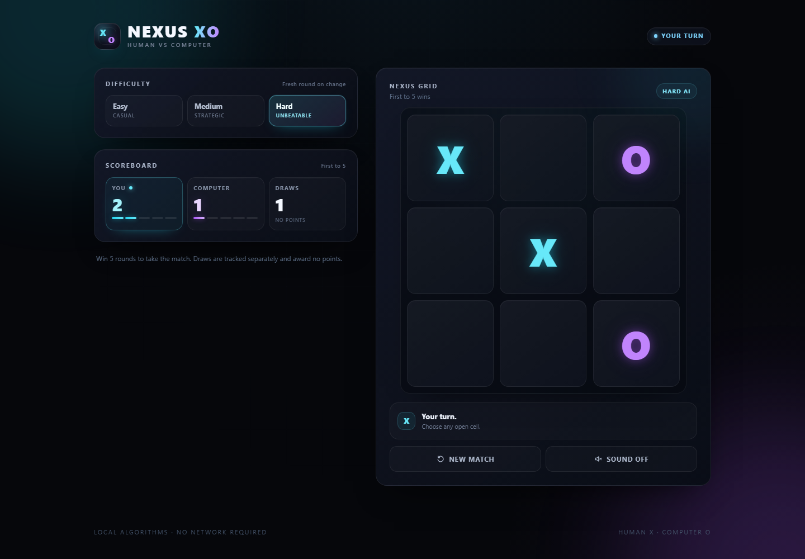
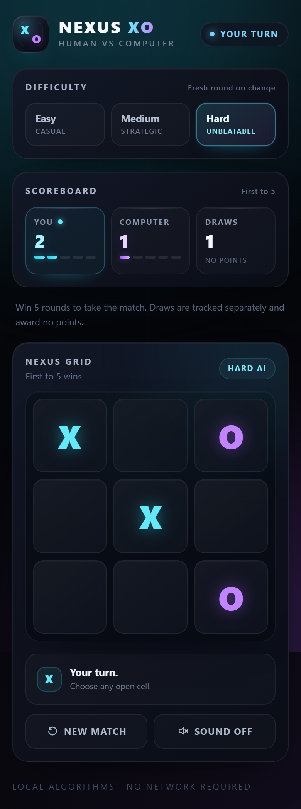

# NEXUS XO

[](https://github.com/suryakishor/Nexus-XO/actions/workflows/ci.yml)
[](https://react.dev)
[](https://www.typescriptlang.org)
[](https://vite.dev)
[](https://tailwindcss.com)
[](https://vitest.dev)
[](https://playwright.dev)
[](LICENSE)

**A polished, human-vs-computer Tic-Tac-Toe game with an unbeatable Minimax opponent, three difficulty levels, and first-to-five match scoring.**

Built with React, TypeScript, and Vite. The game runs entirely in the browser — no backend, API keys, or external AI services.



## Overview

NEXUS XO is a complete browser game rather than a demo. You play as **X** against a computer opponent that makes its own decisions using locally implemented algorithms. Each round is a standard 3 × 3 game; the first player to win **five rounds** takes the match, and an accessible modal presents the result with a Play Again action.

The project emphasizes clean separation of concerns: game rules, AI, state transitions, persistence, and presentation live in independent modules. The result is a small codebase that is easy to reason about, test exhaustively, and extend.

## Features

- **Three difficulty levels** — Easy (random), Medium (heuristic), and Hard (unbeatable Minimax).
- **Depth-aware Minimax** — prefers faster wins, delays unavoidable losses, and randomizes among equally optimal moves.
- **Match-based scoring** — human wins, computer wins, and draws are tracked separately; first to five wins ends the match.
- **Session persistence** — `sessionStorage` preserves the match across refreshes without leaking scores between browser sessions.
- **Responsive dark interface** — designed for desktop, tablet, and mobile, with animated marks and winning-line highlighting.
- **Accessible by default** — keyboard-operable controls, visible focus states, ARIA labelling, and reduced-motion support.
- **Optional sound effects** — generated at runtime with the Web Audio API; no audio assets required.
- **Fully client-side** — no network requests during gameplay.

## Engineering highlights

- Pure, side-effect-free game logic with exhaustive unit coverage.
- A reducer owns scoring and match transitions, keeping components free of game rules.
- AI is isolated behind a single `getComputerMove` interface, so difficulty strategies are independently testable.
- Minimax positions are memoized by board state and turn, keeping the full game-tree test fast.
- 52 unit and component tests plus 3 Playwright end-to-end journeys, including a proof that Hard mode cannot be beaten.
- GitHub Actions runs formatting, linting, tests, the production build, and E2E tests on every push and pull request.

## Tech stack

| Layer         | Technology                                  |
| ------------- | ------------------------------------------- |
| UI            | React 19, TypeScript 5.9                    |
| Build tooling | Vite 7                                      |
| Styling       | Tailwind CSS 4, custom CSS and animations   |
| Testing       | Vitest 4, React Testing Library, Playwright |
| Code quality  | ESLint 10, Prettier 3                       |
| CI            | GitHub Actions                              |

## Screenshots

The layout adapts from a two-column desktop view to a single-column mobile view without losing any controls.



## Getting started

### Requirements

- Node.js 20.19+ or 22.12+
- npm

### Run locally

```bash
npm install
npm run dev
```

Open the URL printed by Vite, normally [http://localhost:5173/](http://localhost:5173/).

### Available commands

| Command                | Purpose                                              |
| ---------------------- | ---------------------------------------------------- |
| `npm run dev`          | Start the Vite development server.                   |
| `npm run build`        | Type-check and create a production build in `dist/`. |
| `npm run preview`      | Preview the production build locally.                |
| `npm run lint`         | Run ESLint over the project.                         |
| `npm run format`       | Format the project with Prettier.                    |
| `npm run format:check` | Check formatting without writing changes.            |
| `npm run test`         | Run Vitest unit and component tests once.            |
| `npm run test:watch`   | Run Vitest in watch mode.                            |
| `npm run test:e2e`     | Run Playwright end-to-end tests.                     |
| `npm run test:e2e:ui`  | Open the Playwright UI test runner.                  |

For end-to-end tests, install the Chromium browser once:

```bash
npx playwright install chromium
```

## Testing and quality

The suite covers the game at every layer:

- **Game logic** — initialization, legal and illegal moves, occupied-cell prevention, wins in every direction, draws, and post-round move rejection.
- **AI behaviour** — Easy move validity, Medium win/block/center/corner priorities, and Hard win/block behaviour.
- **Minimax correctness** — a full game-tree exploration that verifies no legal human strategy can defeat Hard mode.
- **State and scoring** — score updates, draw counting, first-to-five completion, duplicate-score prevention, Play Again resets, and difficulty changes.
- **Persistence** — session restore, new-session behaviour, and confirmation that `localStorage` is not used.
- **Components and E2E** — board interaction, automatic computer turns, modal behaviour, and responsive layouts at 360, 390, 768, 1024, and 1440 pixels.

Run the same quality gate used by CI:

```bash
npm run format:check
npm run lint
npm run test
npm run build
npm run test:e2e
```

## Architecture

```text
nexus-xo/
├── .github/workflows/ci.yml
├── docs/screenshots/
├── public/
├── src/
│   ├── components/          # Presentational UI
│   ├── game/
│   │   ├── ai.ts            # Difficulty strategies
│   │   ├── gameLogic.ts     # Rules and win detection
│   │   ├── gameState.ts     # Reducer and match transitions
│   │   ├── minimax.ts       # Hard-mode solver
│   │   └── types.ts
│   ├── hooks/useGame.ts     # State, AI scheduling, persistence
│   ├── utils/               # sessionStorage and Web Audio helpers
│   ├── App.tsx
│   └── main.tsx
├── tests/e2e/
├── index.html
├── playwright.config.ts
├── vite.config.ts
└── package.json
```

### Design principles

- **Rules are pure functions.** `gameLogic.ts` has no React dependency and can be tested in isolation.
- **State changes flow through a reducer.** `gameState.ts` is the single owner of scoring and match transitions.
- **UI contains no game rules.** Components render state and emit intent; they do not decide outcomes.
- **AI is replaceable.** `getComputerMove` is the only entry point, so new strategies can be added without touching the UI.
- **Persistence is best-effort.** Storage failures are handled gracefully, and React state remains the source of truth.

## How the AI works

| Level  | Strategy                                                                                                                                    |
| ------ | ------------------------------------------------------------------------------------------------------------------------------------------- |
| Easy   | Selects uniformly from the available cells.                                                                                                 |
| Medium | Takes an immediate win, blocks an immediate human win, prefers the center, then prefers corners, and otherwise chooses a random valid move. |
| Hard   | Uses Minimax to evaluate the full game tree. Prefers faster wins, delays unavoidable losses, and randomizes among equally optimal moves.    |

Hard mode scores terminal positions relative to the computer:

- Computer win: `10 - marksPlayed`, so faster wins rank higher.
- Human win: `marksPlayed - 10`, so unavoidable losses are delayed.
- Draw: `0`.

Positions are memoized by board state and turn. All moves tied for the best score are collected, and one is chosen at random, which keeps the opponent unbeatable without making it predictable.

## Session and score handling

- React state is the primary source of truth.
- Scores, difficulty, and sound preference are mirrored to `sessionStorage` under `nexus-xo:session:v1`.
- Refreshing the page restores the current match.
- Closing the tab starts a new session at zero scores.
- `localStorage` is never used for scores.
- Starting a new match resets all scores; changing difficulty starts a fresh round while preserving the match score.

## Production build

Create and verify a production build locally:

```bash
npm run build
npm run preview
```

The optimized assets are written to `dist/`. There are no environment variables to configure.

## License

Released under the [MIT License](LICENSE).
